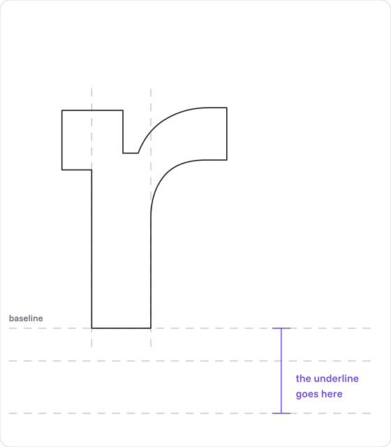
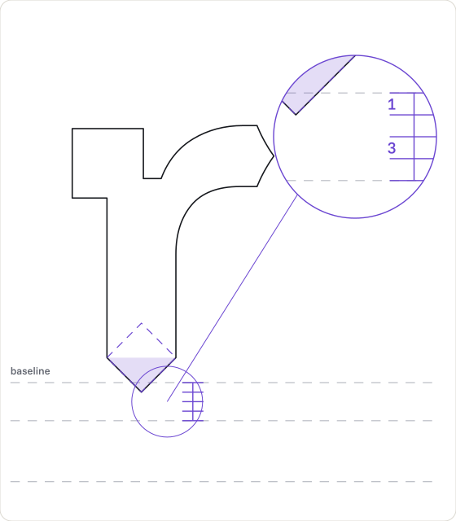
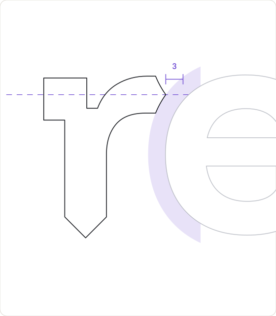
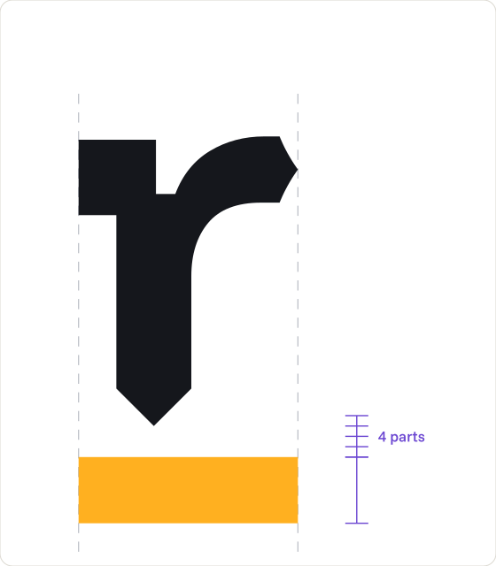
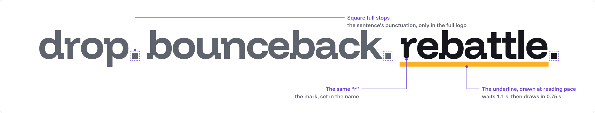
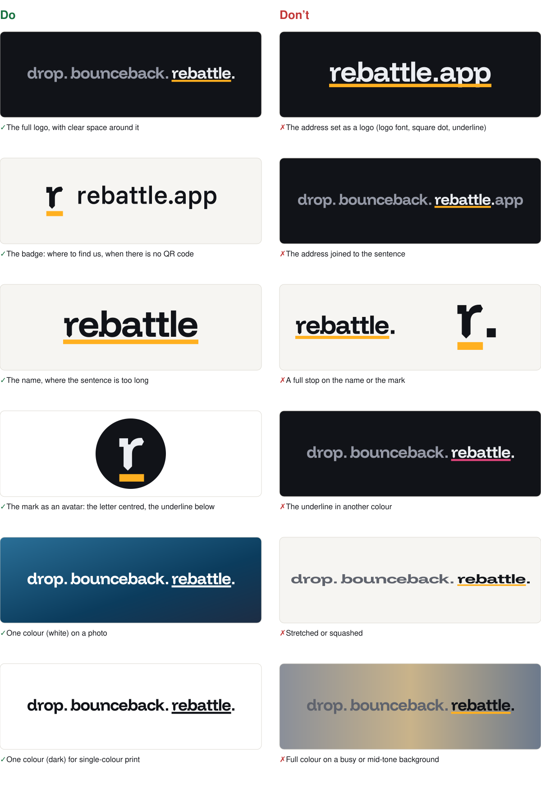

# Brand

The public version of this page is **[rebattle.app/brand](https://rebattle.app/brand)** (`public/js/ui/brand.js`), with every logo file to download. This file is the source: when a rule or a value changes here, change the page in the same pull request (`tests/brand.test.js` checks the colours match).

## Name and logo

- Name: **rebattle**, always lowercase.
- Logo: the whole sentence `drop. bounceback. rebattle.`. The name comes last; there is no separate tagline.
  - "drop." and "bounceback." in the muted colour, "rebattle." in full colour.
  - Full stops are **squares** (stem-width) in the logo only. Running text uses normal dots.
  - "bounceback" is one word in the logo only; in sentences it's "bounce back".
  - Amber underline under the whole word "rebattle". Where it animates (home screen, video intro) it waits while "drop. bounceback." is read (~1.1s), then draws left to right over ~0.75s.
- Short mark / icon: the logo's "r" (below) with the amber underline from the letter's left ink edge to the bounce's tip. App icons, favicon and the Instagram picture: `tools/make-icons.py`, from the outlines `tools/make-logo.py` writes (run that first).
- Placing the mark: in a **round** crop (avatars, the Instagram picture) centre the **letter** (its top to the baseline) and let the underline hang below; in square and rounded-square tiles (app icons, favicon) centre the **whole mark**.

### The logo's "r": the drop and the bounce

The "r" of "rebattle" (and the mark) is Funnel Display Bold's r with two points, the name told in one letter:

- **The drop:** the stem ends in half a square pointing down (as long as half the stem's width, like the square corner at the r's top left). Its tip sits a quarter of the way from the baseline to the underline.
- **The bounce:** the arm ends in a point whose sides curve with the "e", keeping the same gap from it as the drop keeps from the underline (three quarters of the underline's distance below the baseline).
- In the mark, the underline runs to the bounce's tip.

Step by step, as on the brand page ("How the logo is made"); 1 part is a quarter of the gap from the baseline to the underline:

| 1. The letter | 2. The drop | 3. The bounce | 4. The mark |
| --- | --- | --- | --- |
|  |  |  |  |



`tools/make-logo-story.py` draws these from the real outlines (and the whole sheet, `public/brand/how/sheet.svg`; `sheet.png` is its screenshot), so they can't drift from the logo. Its captions are also on the page (`STORY` in `public/js/ui/brand.js`); a test checks they match.

Only the logo has it: "drop." in the full logo and all running text keep the font's own r. It is drawn by `logo_r()` in `tools/make-logo.py`; everything that shows the logo uses those outlines (the app reads them from `public/js/ui/logo-outlines.js`, written by the same script).
- Competition screens: competition name on the left, logo on the right (the short mark on phones).

## Logo set

Three versions and a badge, each in four colourways: `public/brand/logos/<version>-<colourway>.svg` and `.png` (transparent), served at `/brand/logos/…` for the brand page. Drawn as outlines from the bundled fonts by `tools/make-logo.py`; the PNGs are headless-Chrome screenshots of the SVGs (full 2400 px wide, name 1600 px wide, mark 1024 px tall, badge 512 px tall). `tools/make-brand-kit.py` then zips everything into `public/brand/rebattle-brand.zip`, the page's "download everything"; run it after changing any of the files (a test checks the zip is up to date).

The file names are public links people save: don't rename them.

| Version | Looks like | Use |
| --- | --- | --- |
| `full` | drop. bounceback. <u>rebattle</u>. | the main logo: README, headers, posters, the video intro |
| `name` | <u>rebattle</u> | where the sentence is too long: the site footer, small headers, partner and sponsor slots |
| `mark` | <u>r</u> | avatars, app icons, favicons, watermarks, the middle of QR codes |
| `badge` | <u>r</u> rebattle.app | where to find us: stickers, slide and email footers, the corner of a layout without a QR code |



| Colourway | On | Text | "drop. bounceback." | Underline |
| --- | --- | --- | --- | --- |
| `on-dark` | dark backgrounds | `#eceef2` | `#9599a6` | amber `#ffb020` |
| `on-light` | light backgrounds | `#111318` | `#5f636d` | amber `#ffb020` |
| `mono-dark` | one-colour print, light | `#111318` | same | same |
| `mono-white` | photos, one-colour on dark | `#ffffff` | same | same |

- **One job per device.** The square full stops are the sentence's punctuation, so they appear only in `full`. The underline is the signature, on all three. The name is "rebattle" with no full stop, and the mark is "r" with no full stop ("r." reads as an abbreviation).
- **Mono means one colour:** text, full stops and underline all in the same ink.
- **Clear space:** keep at least the height of the "r" (its x-height) free around any version. **Minimum sizes:** `full` 120 px / 30 mm wide, `name` 48 px / 12 mm wide, `mark` 16 px tall.
- **Don't:** recolour the underline in the full-colour versions, put the full stops on `name` or `mark`, stretch, outline or add effects, set the logo in any other font, or type it in Funnel Display (that loses the logo's "r": use the outlines).

## The address: rebattle.app

`rebattle.app` is text, not a logo: set in **Funnel Sans** (the text font), with a **round dot**, **no underline**, in the same colour as the text around it (bolder for emphasis on posters). Never set it in Funnel Display, never with square full stops or the underline, and never combined with a logo as if it were one: put it under or next to the logo, as a line of text.

- **The badge** (`badge`: the mark next to the address, its x-height centred on the "r") is the one fixed "where to find us" element.
- **Next to a QR code, just the address:** the QR code carries the "r" in its middle, so a badge beside it would repeat it. A poster puts the logo at the top and, at the bottom, the QR code with "rebattle.app" as text.
- **Everywhere else the address is plain text** in the layout: the end of the replay video, the Instagram bio, the back of a shirt.

## Type

- **Funnel Display** for the logo, headings and big video titles; **Funnel Sans** for everything else. Bundled in `public/fonts/` (SIL OFL), latin + latin-ext.
- Tabular numbers wherever places or counts line up.

## Colour

| Token | Value | Use |
| --- | --- | --- |
| `--accent` | `#ffb020` amber | the one accent: primary buttons, ready heats, focus, logo underline |
| `--win` | `#35c17a` green | advances, winner's path |
| `--losers` | `#a685ff` violet | Losers bracket, drops, runners-up |
| `--lose` | `#e35b5b` red | out (lost twice) only |
| `--bg` / `--panel` / `--panel-2` | `#111318` / `#181b22` / `#20232c` | neutral dark greys, slightly warm |

**Day colours** (light theme, `[data-theme="light"]` in `public/styles.css`; Auto follows the device, or the footer's Light / Dark switch): warm off-white page `#f6f5f2`, white cards, borders `#dcd9d1`, text `#15171c`, muted `#5f636d`. Amber stays `#ffb020` where it is a fill (buttons, the logo underline, ready heats); as text or a thin line it is `#8f5c00` / `#8a5a00`. Green `#17713f`, violet `#6a45d1`, red `#c23737`. Every text colour is at least 4.5:1 on white cards (WCAG AA). Finished heats fade less than in the dark theme (`--fade-*`), so their text stays readable. The replay video stays dark in both themes: it is a file people post, so it looks the same whatever device made it.

In the video, blue `#4f8cff` marks the Winners bracket (opposite violet for Losers); the app uses it (`--winners`) only for the intro's Winners bracket step.

## Wording

- "Winners bracket" / "Losers bracket"; short forms WB / LB.
- Final 4 origins: **WB 1st, WB 2nd, LB 1st, LB 2nd**.
- "Random draw" for Losers-bracket pairings; "Bye" for no opponent; "Out" for eliminated.

## Link preview

What LinkedIn, WhatsApp, iMessage and the rest show when someone shares a rebattle.app link: `public/icons/share-preview.png` (1200×630), the full logo on the dark background, the tagline "Double-elimination brackets, run from your phone." in Funnel Sans and the address at the bottom. `tools/make-logo.py` writes it as outlines to `public/brand/share-preview.svg`; the PNG is a 1200×630 headless-Chrome screenshot of it. The tags that point to it are in `public/index.html` (docs/architecture.md, Hosting).

## Instagram: @rebattle.app

- **Profile picture:** `public/brand/instagram/profile.png` (1080×1080; the "r" mark on the dark background, the letter centred in the round crop with the underline below it, and still readable at 44 px). Rebuild the SVG with `tools/make-icons.py`; the PNG is a 1080 px screenshot of it.
- **Name:** rebattle
- **Bio** (120 of 150 characters):

  ```
  drop. bounceback. rebattle.
  Double-elimination brackets, run from your phone.
  Live results · rider pages · replay videos
  ```
- **Link:** https://rebattle.app
- **Content:** the replay videos are made for Reels and Stories (1080×1920); a rider's journey video is a ready-made post for that rider to share.
- **Video cover:** `public/brand/instagram/video-cover.png` (1080×1920), the same for every contest: the full logo dead centre (so it survives the 4:5 and square crops of the profile grid) and rebattle.app at the bottom. Pick it as the cover when posting a replay; the video's own first frame is dark, as the intro fades in. `tools/make-logo.py` writes the SVG; the PNG is a 1080×1920 screenshot of it. Offered on /brand and in the zip.

## README screenshots

`docs/screenshots/` holds the app as the README shows it: `bracket-<light|dark>.png` (the Winners bracket on a 1440 px desktop) and `phone-<light|dark>.png` (a rider's page on a 390 px phone, at 2×). `tools/make-screenshots.mjs` makes them from a made-up tournament (invented riders, a fixed random seed) in headless Chrome; rerun it after changing how the bracket or the rider page looks. They aren't part of the site.
